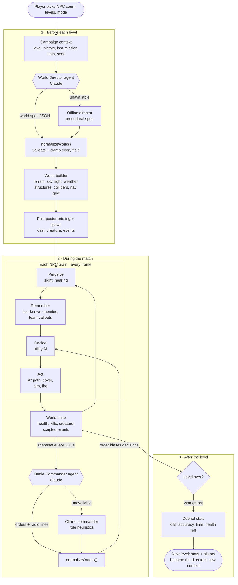
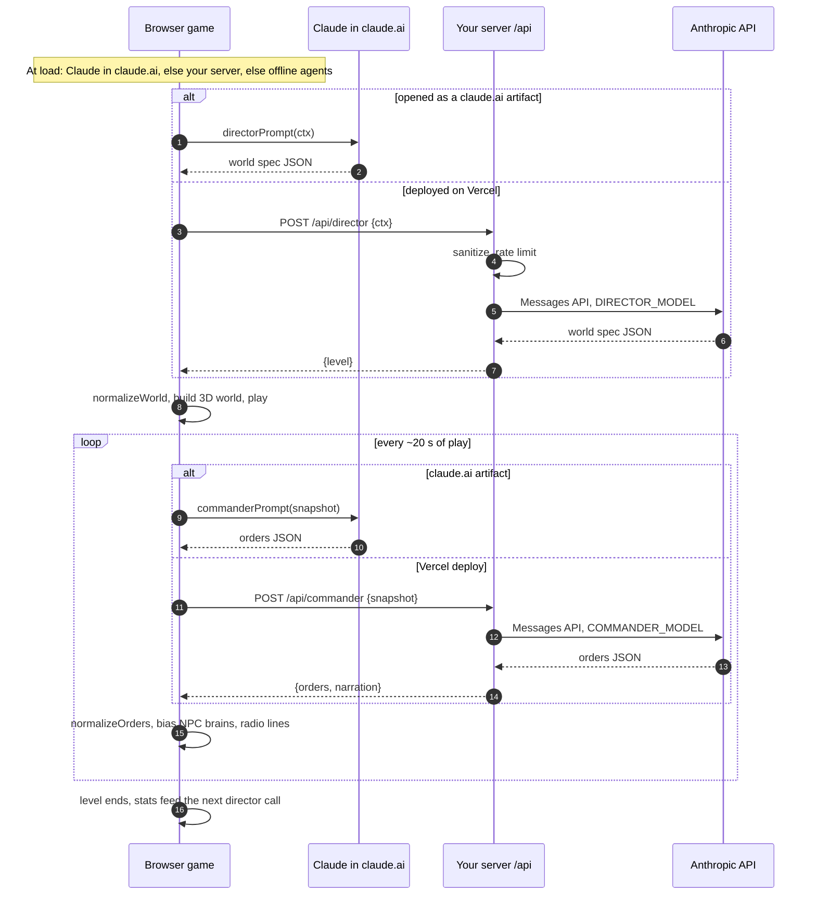

# Killhouse: an agentic AI world builder

Demo link: https://www.youtube.com/watch?v=X0oEfGyjB8Y

A cinematic, first-person 3D shooter in the browser (three.js / WebGL). Every level is staged like a different film, and three layers of AI run it:

| Agent | Runs | What it decides |
|---|---|---|
| **World Director** | once per level (`/api/director`) | Film title, tagline, logline and genre; one of 8 world archetypes; sun position, sky tint, fog, weather and time of day; colour palette; landmark and points of interest; the creature (titan ape, raptor pack, sky beasts); 1–3 scripted mid-level events; a named cast of NPCs with role, traits, bio and radio quirk; soundtrack mood; difficulty, adapted to how you played the last level |
| **Battle Commander** | every ~20 s during play (`/api/commander`) | Reads a battlefield snapshot (positions, health, ammo, morale, who sees whom, the creature) and gives each NPC an order (engage, flank, cover, hunt, retreat, regroup, ambush, evade, hold) plus a radio line in that operator's voice |
| **NPC brains** | every frame, in the browser | Each operator perceives (field of view, line of sight, hearing gunfire), keeps a memory of enemy positions, shares callouts with teammates, scores actions with utility AI biased by the commander's order, finds cover, plans A* paths around obstacles, peeks, reloads, heals and loses morale when allies fall |

### The eight worlds

`primeval_island` (jungle island, stepped temple, titan ape) · `vertical_pit` (brutalist prison shaft with a feast platform travelling the void) · `neon_megacity` (rain-soaked streets, neon, holo billboards) · `frozen_station` (polar base under an aurora) · `desert_colossi` (dunes, colossal statues, sandstorms) · `volcanic_forge` (lava rivers, iron towers) · `shadow_realm` (inverted floating city, tendrils, red lightning) · `drowned_city` (flooded ruins, colossal torch-bearer)

Rendering: physically based materials, an atmospheric sky (or a starfield at night), image-based lighting, soft shadows, exponential fog, ACES tone mapping and bloom. Particle weather (rain, snow, sand, ash, spores), lightning, aurora shaders and animated lava/water, plus a procedural score and positional sound effects.

## Agentic workflow

A campaign is a loop of three stages. Claude makes two kinds of decisions: the **World Director** designs each level, and the **Battle Commander** steers the fight every ~20 seconds. Each NPC's own brain runs every frame in the browser, and the commander's orders bias what it chooses. Every agent output passes through a validator (`normalizeWorld`, `normalizeOrders`) before it can affect the game, and each agent has an offline fallback.



### Where the Claude calls go

Inside claude.ai the game calls Claude on the viewer's own account. On a Vercel deploy it calls your `/api` functions, which call the Anthropic API with your key. With neither available, the offline agents take over.



## Architecture

```
public/
  index.html   UI shell: menu, film-poster briefing, intro, HUD
  game.js      renderer, player, NPC brains, creatures, combat, audio, agent clients
  world.js     turns a world spec into a lit 3D level + colliders + nav grid
  agents.js    prompts + validators for both agents, offline fallbacks (shared with the server)
api/
  director.js  POST {ctx}  -> {level}
  commander.js POST {snap} -> {orders, narration}
  _lib.js      sanitizing, rate limiting, Anthropic call, tolerant JSON parse
```

The browser picks an agent backend at runtime: **Claude inside claude.ai** (when opened as a claude.ai artifact) → **your server** (`GET /api/director` returns `{ok:true}`) → **offline agents** (procedural director + heuristic commander), so the game never breaks. Every value an agent returns is validated and clamped (`normalizeWorld`, `normalizeOrders`) before it touches the game.

No build step. three.js loads from jsDelivr through an import map.

## Deploy to a production URL (Vercel)

1. **Get an API key.** Create one at https://console.anthropic.com and set a monthly spend limit there.
2. **Push to GitHub.**
   ```bash
   git add . && git commit -m "Killhouse 3D: AI director, commander and agentic NPCs"
   git branch -M main
   git remote add origin git@github.com:<you>/agentic-ai-world-builder.git   # skip if it already exists
   git push -u origin main
   ```
3. **Import into Vercel.** At https://vercel.com/new, import the repo. Framework preset: **Other**. Leave the build command empty. Vercel serves `public/` and turns `api/*.js` into serverless functions (files starting with `_` are not routes).
4. **Set environment variables** (Project → Settings → Environment Variables), then redeploy:
   - `ANTHROPIC_API_KEY` (required)
   - `DIRECTOR_MODEL` (optional, default `claude-sonnet-5-5`; richer worlds)
   - `COMMANDER_MODEL` (optional, default `claude-haiku-5-5`; fast tactical turns)
5. **Verify.** `https://<project>.vercel.app/api/director` should return `{"ok":true,...}`, and the game menu should say *"Agents online: Claude via the game server"*.
6. **Custom domain** (optional): Project → Settings → Domains.

Local development: `cp .env.example .env.local`, add your key, run `npx vercel dev`, then open http://localhost:3000.

### Costs and limits

One director call per level (~3–4k output tokens) and one commander call every ~20 s of play (~1k tokens). The built-in limiter allows 6 levels and 10 commander turns per minute per IP, per instance. For real traffic, swap it for Upstash Redis (`@upstash/ratelimit`) or Vercel Firewall rules.

## Next steps

- **Real multiplayer:** add a WebSocket room server (PartyKit, Colyseus, or a small Node + `ws` service on Fly.io/Render) so several humans share one director-built world, with the NPC brains running on the server.
- **Leaderboards:** Vercel KV or Supabase keyed by world seed.
- **Asset upgrade:** swap the procedural meshes for glTF models (e.g. CC0 packs from Quaternius or Kenney) loaded with `GLTFLoader`; the director keeps choosing which kit to stage.
- **Director tool use:** expose `spawn_wave`, `move_creature` and `trigger_event` as tools so the director keeps directing live during play, not just at the start.

## Controls

WASD move · mouse look · left click fire · right click aim down sights · Shift sprint · C crouch · Space jump · R reload · Esc pause.
Touch: left thumb moves, right thumb looks, on-screen fire / aim / reload / jump buttons.
